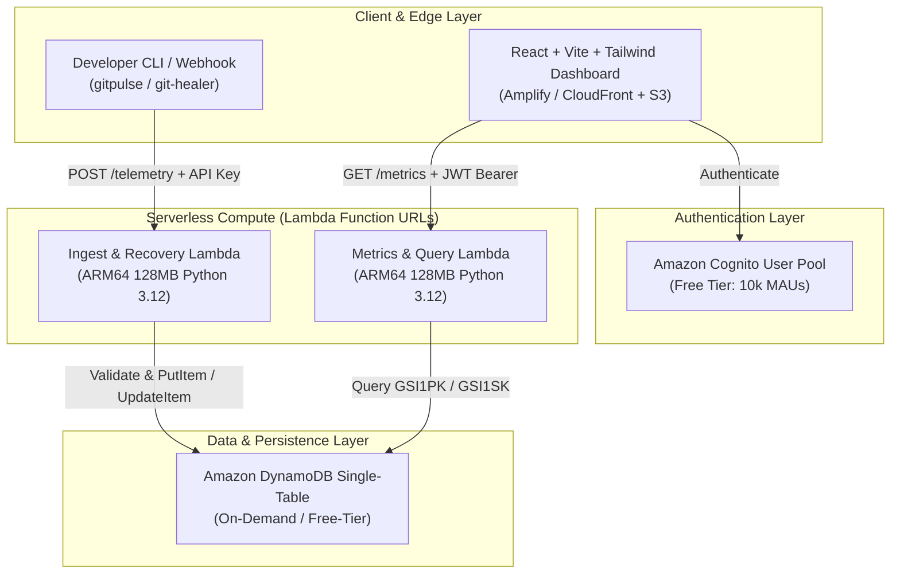
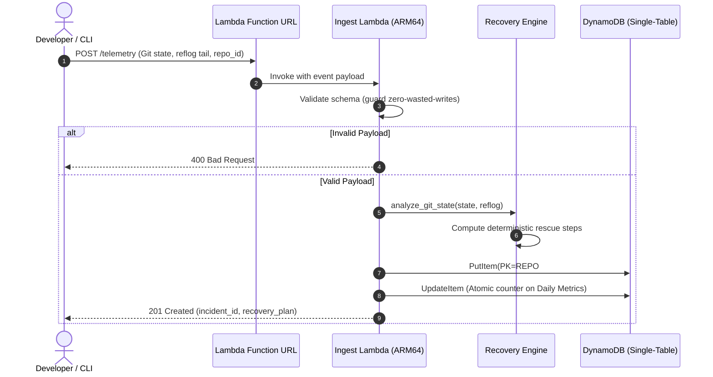
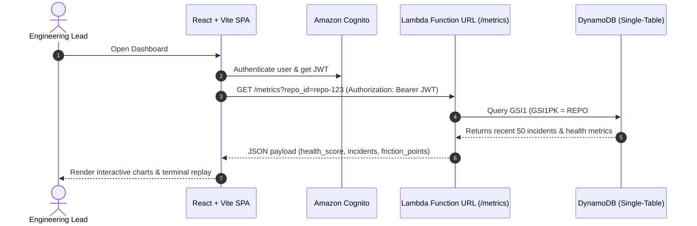

# Design Specification: Git Recovery & Telemetry Hub

## 1. High-Level Architecture Overview

The GitPulse system operates on an event-driven, scale-to-zero serverless architecture designed to eliminate idle costs while delivering sub-200ms recovery generation.



---

## 2. Single-Table DynamoDB Design

All application entities reside in a single table named `gitpulse_core`.

### Primary Keys & GSI Structure
- **Table Partition Key (PK):** `String`
- **Table Sort Key (SK):** `String`
- **GSI1 Partition Key (GSI1PK):** `String`
- **GSI1 Sort Key (GSI1SK):** `String`

### Entity Access Patterns Table

| Entity | PK | SK | GSI1PK | GSI1SK | Attributes |
| :--- | :--- | :--- | :--- | :--- | :--- |
| **Repository Metadata** | `REPO#<repo_id>` | `METADATA` | `ORG#<org_id>` | `REPO#<repo_id>` | `name`, `default_branch`, `created_at`, `health_score` |
| **Incident Telemetry** | `REPO#<repo_id>` | `INCIDENT#<timestamp>#<incident_id>` | `REPO#<repo_id>` | `INCIDENT#<timestamp>` | `incident_id`, `state_type`, `head_commit`, `reflog_tail`, `recovery_plan`, `status` |
| **Recovery Playbook** | `INCIDENT#<incident_id>` | `RECOVERY` | `REPO#<repo_id>` | `STATUS#<status>` | `steps[]`, `safety_level`, `created_at`, `executed_at` |
| **Repository Daily Metrics** | `REPO#<repo_id>` | `METRICS#<date_YYYY-MM-DD>` | `ORG#<org_id>` | `DATE#<date>` | `total_incidents`, `resolved_incidents`, `avg_resolution_ms` |

---

## 3. Sequence Diagrams

### 3.1 Telemetry Ingestion & Deterministic Recovery Computation



### 3.2 Dashboard Telemetry & Metrics Querying



---

## 4. Deterministic Recovery Algorithm Specification

The recovery engine executes state-machine graph traversal on the received `reflog_tail` and `branch_state`:
1. **Detached HEAD State (`DETACHED_HEAD`):**
   - Identify current `HEAD` SHA.
   - Scan reflog backwards to find the last known branch checkout transition (`checkout: moving from <branch> to <hash>`).
   - Emit safe commands:
     ```bash
     git branch rescue-<timestamp> <HEAD_SHA>
     git checkout <last_known_branch>
     git merge rescue-<timestamp> --ff-only || echo "Manual merge inspection required"
     ```
2. **Botched Interactive Rebase (`IN_PROGRESS_REBASE`):**
   - Check presence of `.git/rebase-merge` or `.git/rebase-apply`.
   - Synthesize differential safety patch:
     ```bash
     git diff > gitpulse_emergency.patch
     git rebase --abort
     ```
3. **Accidental Hard Reset (`ACCIDENTAL_RESET`):**
   - Identify prior commit before reset in `HEAD@{1}` or `HEAD@{2}`.
   - Synthesize recovery branch:
     ```bash
     git branch recovered-work HEAD@{1}
     ```

---

## 5. Security & Cost Optimization Verification
- **No NAT Gateway:** Handlers run in default serverless environment with direct AWS service endpoints.
- **Function URLs:** Eliminates API Gateway base cost.
- **Boto3 Client Caching:** Single client instantiated globally across container warm starts.
- **Sub-150ms Execution:** Keeps GB-seconds comfortably inside AWS Always-Free Tier limits.
